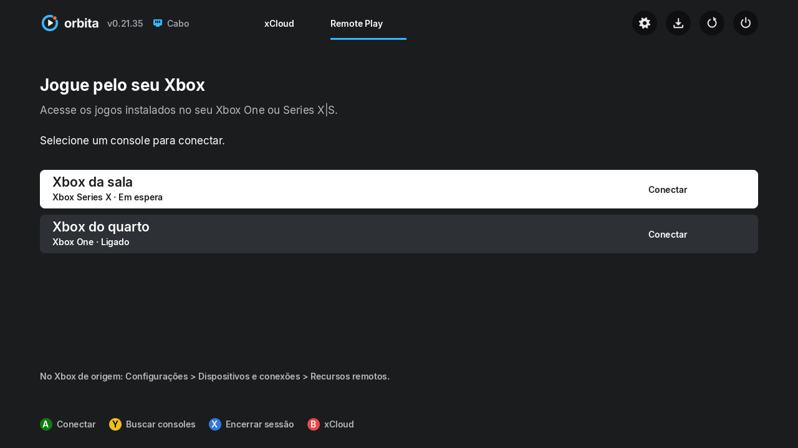

# Remote Play no orbita

Implementação experimental: o Xbox 360 com RGH/JTAG recebe a transmissão de
um Xbox One ou Xbox Series X|S da conta Microsoft. O Xbox 360 é o cliente;
esta mudança não transforma o 360 em servidor de Remote Play.

## Como o projeto funciona

O aplicativo principal é `source/main.c`, escrito em C para libxenon e iniciado
pelo XeLL. Não usa navegador, XDK nem um PC intermediário.

1. `login/login_flow.c` faz login Microsoft por código, renova o token salvo
   em `XC360/TOKEN.TXT` e obtém as credenciais Xbox Live/XSTS.
2. `login/xbox_auth.c` troca essas credenciais pelo token do serviço de
   streaming e pela região. O catálogo de jogos e as capas têm módulos próprios.
3. `session/xc_session.c` faz as chamadas HTTPS; `session/xs_machine.c` coordena
   autenticação, provisionamento, negociação SDP/ICE, manutenção e encerramento.
4. `native/xc_native.c` conecta a sessão ao receptor `webrtc/`, que recebe
   H.264 e Opus e envia comandos dos controles pelos canais de dados.
5. O decoder entrega vídeo à GPU Xenos, o módulo de áudio reproduz o som e
   `ui/` desenha o menu nativo em 1280×720.

O menu roda na thread de hardware 0; rede/WebRTC na 1. Login, capas,
atualização e abertura de sessão compartilham a 3, que também pode ser cedida
ao decoder durante o jogo. A busca de consoles respeita essa exclusão.

## O que foi adicionado

- Abas **xCloud** e **Remote Play** no cabeçalho, acessíveis com o controle.
- Busca dos consoles da conta pelo serviço `xhome`, independente do catálogo
  e da assinatura do xCloud. Nome, modelo e estado de energia aparecem na lista.
- Início da sessão pelo `serverId`, reaproveitando vídeo, áudio, controles,
  manutenção da conexão, retomada e encerramento existentes.
- Estados de busca, lista vazia e erro; rolagem para listas maiores.
- Separação entre credenciais/sessões de nuvem e de console. O início do
  Remote Play não apaga sessões antigas do xCloud e não solicita seu token
  de transferência (`passport`/`connect`).
- A busca não substitui o catálogo, e os consoles não entram no histórico
  de jogos da nuvem. Tokens continuam fora dos logs.

## Como usar depois de compilar

1. No Xbox One/Series, use a mesma conta Microsoft e ative
   **Configurações > Dispositivos e conexões > Recursos remotos**. Deixe o
   console ligado ou com uma configuração de energia que permita acesso remoto.
2. Entre na conta pelo orbita e aguarde o carregamento da biblioteca xCloud
   terminar. O login fica salvo no pendrive. O atalho RB das telas de
   carregamento e falha foi removido; abra Remote Play pela aba na home.
3. Na home, suba até o cabeçalho, selecione **Remote Play** e aperte **A**.
4. Use baixo para entrar na lista, cima/baixo para escolher e **A** para conectar.

| Controle na aba | Ação |
|---|---|
| Cima na primeira opção | Volta ao cabeçalho |
| Esquerda/direita no cabeçalho | Seleciona uma aba ou botão |
| A | Abre a opção ou conecta ao console selecionado |
| Y | Busca os consoles novamente |
| X | Encerra a sessão de streaming aberta; não desliga o Xbox de origem |
| B | Cancela uma conexão pendente ou volta para xCloud |
| Guia | Abre as configurações do orbita |

Dentro do jogo, **Back + Start por 2 segundos** retorna ao menu mantendo a
sessão. Selecione o mesmo console e aperte A para retomar. Para trocar de
console ou de modalidade, a sessão anterior é encerrada primeiro. Encerre
uma sessão aberta com X antes de atualizar a lista de consoles.

## Protocolo e referências

O login usa `offeringId: xhome` em
`https://xhome.gssv-play-prod.xboxlive.com/v2/login/user`. A região vem da
resposta; quando não há `isDefault`, usa a primeira região informada.

Na região retornada:

| Operação | Chamada |
|---|---|
| Listar consoles | `GET /v6/servers/home?mr=50` |
| Iniciar | `POST /v5/sessions/home/play`, com `serverId` e `titleId` vazio |
| Aguardar o console | `GET <sessionPath>/state` até `Provisioned` |
| Negociar transporte | `POST/GET <sessionPath>/sdp` e `/ice` |
| Manter conexão | `POST <sessionPath>/keepalive` |
| Encerrar transmissão | `DELETE <sessionPath>` |

São interfaces usadas por clientes independentes, sujeitas a mudanças.
Referências consultadas em 28/10/2026:

- [Requisitos e finalidade oficiais do Remote Play](https://www.xbox.com/pt-BR/consoles/remote-play).
- [Código do Better xCloud: autenticação e descoberta de consoles](https://github.com/redphx/better-xcloud/blob/main/better-xcloud.user.js).
- [XStreaming: início e negociação de uma sessão de console](https://github.com/Geocld/XStreaming/blob/main/docs/3.Stream.md).

## Validação e limites

Foram compilados e executados os testes de sessão, menu e UI no Windows com
MSVC em C11, usando adaptações temporárias de cabeçalhos POSIX/GNU somente
para os testes. A suíte de sessão passou com **18.943 verificações e zero
falhas**, incluindo o fluxo simulado de Remote Play. Também foram atualizadas
duas expectativas antigas da fila do xCloud para os textos já usados pela versão
atual do projeto.

A simulação cobre descoberta, respostas inválidas, duplicatas, limite de
consoles, credenciais `xhome`, região sem `isDefault`, renovação após HTTP 401,
SDP/ICE, keepalive, console inacessível e DELETE. Os testes de UI cobrem
redesenho, rolagem, erros, confirmação de energia e volta à home. As seis
cenas do renderizador nativo foram geradas para inspeção visual.

No ambiente Linux de desenvolvimento do projeto:

```sh
app/h264play/hosttest/session/run_session.sh unit
app/h264play/hosttest/ui/run.sh
app/h264play/hosttest/run.sh
```

`hosttest/ui/remote_mockup.c` gera as cenas `list`, `empty`, `busy`, `error`,
`scroll` e `home`; `ui/run.sh` as salva como PPM em `hosttest/ui/out/`.

## Integração e validação

Base: revisão `8300c37` do repositório original, com seus patches USB
`libxenon-v02141-usb-boot.patch` e `libxenon-v02143-fullspeed.py` na libxenon.
O patch adicional `deps/patches/libxenon-ehci-independent-init.patch` permite
tentar os dois controladores mesmo se um deles não inicializar.

O Wi-Fi e o pendrive no mesmo EHCI passam a usar exclusão de DMA antes do
ACK do disco, com prazo limitado e retomada do anel depois do acesso.
Portas já enumeradas são preservadas pelo monitor de hotplug. Escritas
diretas de diagnóstico por outra thread são recusadas se disputarem esse EHCI.

Validação no PC: 18.943 verificações de sessão (ASan/UBSan), menu, renderização
das telas reais e configurações (422 verificações). No Wi-Fi passaram 2.676
verificações unitárias e PMK/PTK x20. O teste da exclusão USB passou em 340
verificações determinísticas e 352 concorrentes, incluindo 32 ciclos de
posse/retomada, recusa de aquisição aninhada e timeout de DMA preso; cada modo
recebeu mais de 120.000 transferências USB.

A build `0.21.44-remote-play-usbfix` teve funcionamento sem os congelamentos
anteriores relatado por um testador no Xbox 360 E. A build seguinte
`0.21.44-remote-play-usbfix2` apenas retira o atalho RB durante carregamento/falha
do catálogo e foi recompilada com as mesmas correções e `BETA=0`. A transmissão
real de um Xbox One/Series ainda requer confirmação; a descoberta do Series
foi relatada após terminar o carregamento do catálogo.

A conexão real depende do estado do Xbox de origem, da região, da rede/NAT e
da compatibilidade do transporte e dos canais de controle existentes com o
console. Esta implementação usa o perfil H.264/Opus de 720p existente; não
adiciona HEVC, HDR, 1080p ou relay TURN. Não pressupõe que todos os jogos ou
todas as redes funcionarão sem ajustes após o primeiro teste físico.


